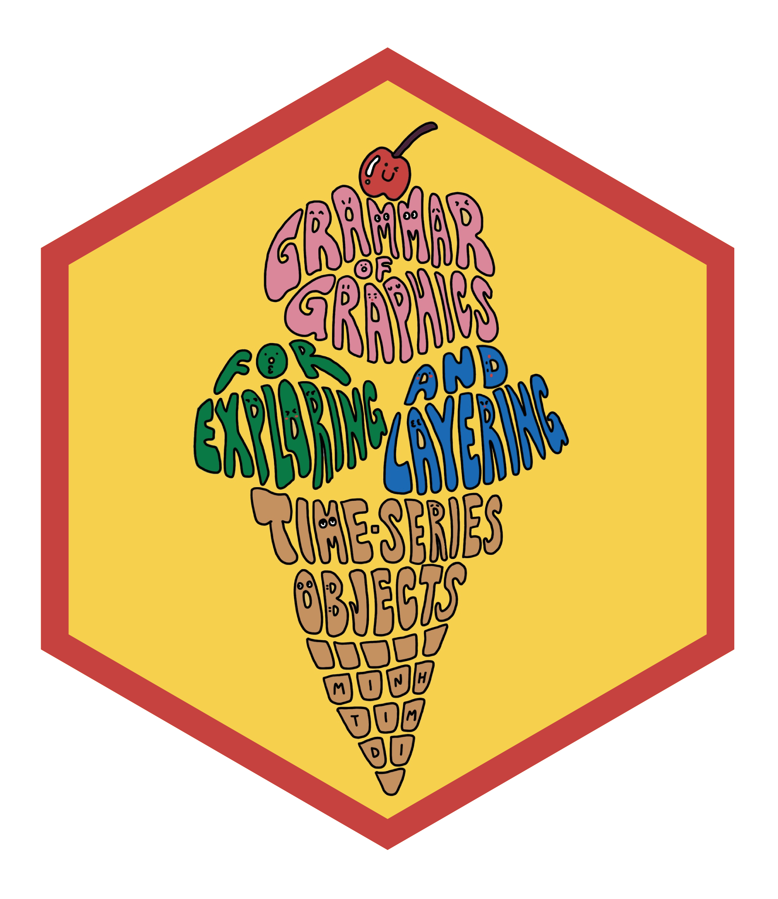

<!-- README.md is generated from README.Rmd. Please edit that file -->

```{r, include = FALSE}
knitr::opts_chunk$set(
  collapse = TRUE,
  comment = "#>",
  fig.path = "man/figures/README-",
  out.width = "100%"
)
```

# ggelato 

<!-- badges: start -->
<!-- badges: end -->

`ggelato`, which stands for "Grammar of graphics for exploring and layering aggregated time-series objects", is an R package for interactively visualising hierarchical time series. User can interact directly with all elements on the plot or with the assistance of the toolbar and hierarchy widget.

## Installation

You can install the development version of ggelato from [GitHub](https://github.com/yvesypher/ggelato.git) with:

``` r
# install.packages("pak")
pak::pak("yvesypher/ggelato")
```

## Example

```r
library(ggelato)
library(fabletools)
library(feasts)
library(tsibble)
library(dplyr)

tourism_hts <- tourism |>
  aggregate_key((State / Region) * Purpose, 
  Trips = sum(Trips))

### Time series features plot

tourism_ft <- tourism_hts |>
  features(Trips, feature_set(pkgs = "feasts"))

tourism_feasts <- gig(tourism_ft,
    gig_aes(x = trend_strength, 
            y = seasonal_strength_year),
    structure = (State/Region)*Purpose) +
  geom_features()

tourism_feasts
  
### STL decomposition plot

stl_original <- tourism_hts |>
  model(stl = STL(Trips)) |>
  components() |>
  as_data_frame()

stl_scaled <- tourism_hts |>
  group_by_key() |>
  mutate(Trips = as.numeric(scale(Trips))) |>
  ungroup() |>
  model(stl = STL(Trips)) |>
  components() |>
  as_tibble()

tourism_stl <- gig(
  stl_original,
  gig_aes(
    x = Quarter,
    y = Trips,
    seasonality = season_year,
    trend = trend,
    remainder = remainder
  ),
  structure = (State / Region) * Purpose
) +
  geom_stl(scaled = stl_scaled)

tourism_stl

### Sunburst
tourism_sunburst <- gig(as_tibble(tourism_hts), 
    structure = (State/Region)*Purpose) +
  geom_sunburst(labels = TRUE) 

tourism_sunburst

### Coordinating multiple plots with `fridge()` in `fridge` `R` package

fridge(tourism_stl,
       tourism_feasts, 
       tourism_sunburst, 
       fullscreen = FALSE) 
```

